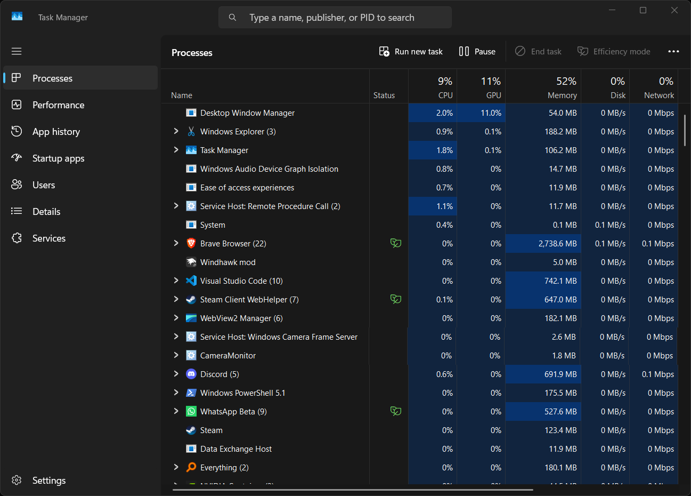

# Task Manager Pause Button

Add a native **Pause / Resume** button next to **Run new task** in the
Windows 11 Task Manager. Pause the list to check process details without
constant updates.

## Features

- Add a native **Pause / Resume** button to the **Processes** and **Details** pages.
- Use the same XAML style as the built-in Task Manager buttons.
- Keep the Pause / Resume state in sync when switching between pages.
- Pause list updates without suspending or stopping Windows processes.
- Work without Windows Registry changes, extra programs, or configuration.

## Installation

1. Install [Windhawk](https://windhawk.net/) if you do not already have it.
2. Open the [Task Manager Pause Button page](https://windhawk.net/mods/task-manager-pause-button), or search for **Task Manager Pause Button** in Windhawk.
3. Click **Install**.

Close and reopen Task Manager if the button does not appear right away.

## How to use

1. Open **Task Manager** and go to **Processes** or **Details**.
2. Click **Pause** next to **Run new task** to hold the current list.
3. Click **Resume** to start updating the list again.

The mod only pauses **Task Manager's display updates**. Your apps and
processes continue to run normally.

## Compatibility and limitations

- Designed for the Windows 11 Task Manager using `Windows.UI.Xaml`.
- Uses Task Manager's built-in **Ctrl-key refresh hold** behavior. It does not change the **Real time update speed** setting.
- Ctrl-based actions inside Task Manager may behave differently while Pause is active.
- Currently detects command bars with **English** or **Portuguese** button labels.
- A Windows update may change the internal XAML interface and require a mod update.

## Troubleshooting

If the button does not appear, confirm that the mod is enabled, close and
reopen Task Manager, and check the **Processes** or **Details** page.

If the issue continues, check the Windhawk log for XAML-related errors.
You can [open a GitHub issue](https://github.com/luizbizzio/task-manager-pause-button/issues)
with your Windows version, the steps to reproduce the problem, and relevant logs.

## Author and license

**Luiz Bizzio**. Licensed under **Apache 2.0**; see [LICENSE](LICENSE).

